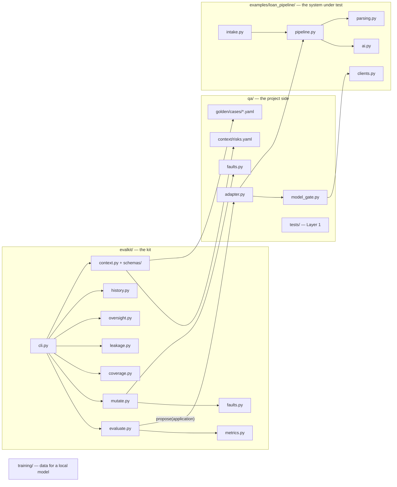
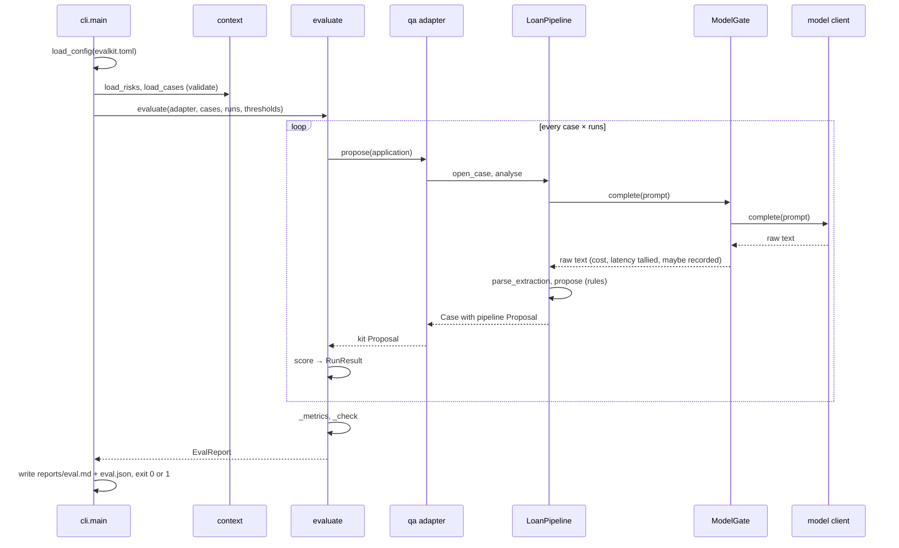
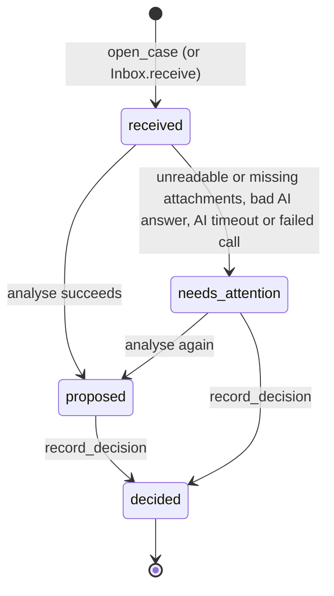

# Guide to the code

How llm-eval-kit is put together: where things start, what each file does, and what happens, step by step, when you run each command. Read the [README](../README.md) first for the why; this is the how.

## The picture

The repo has four parts. Only the first is the reusable kit; the rest show it working on one system.

| Folder | Owner | Rule of thumb |
| --- | --- | --- |
| `evalkit/` | kit | Knows nothing about loans. Reusable as is. |
| `qa/` | project | Everything specific to *this* system: risks, golden cases, faults, the adapter, Layer 1 tests. |
| `examples/loan_pipeline/` | demo | Stands in for the real system. It never imports `evalkit` or `qa`, just as a real product wouldn't. |
| `training/` | project | Synthetic data and config for fine-tuning a local model. |
| `tests/` | kit | Unit tests for `evalkit/`, plus the model gate and the training data. |

The direction of imports is the design: `qa` imports both `evalkit` and the pipeline; the pipeline imports neither. Point the kit at a different system by rewriting `qa/` and deleting `examples/`.

## Entry points

Everything starts in one of these places.

| You run | It starts in | Reads | Writes |
| --- | --- | --- | --- |
| `evalkit <command>` | [`evalkit/cli.py`](../evalkit/cli.py) `main()`, registered in [`pyproject.toml`](../pyproject.toml) under `[project.scripts]` | [`evalkit.toml`](../evalkit.toml), risks, golden cases | `reports/eval.md`, `reports/eval.json` (for `eval`) |
| `python -m evalkit` | [`evalkit/__main__.py`](../evalkit/__main__.py), which calls the same `main()` | same | same |
| `pytest` | pytest itself; [`pyproject.toml`](../pyproject.toml) `[tool.pytest.ini_options]` sets `testpaths`, puts the repo root on `sys.path` and registers the `covers` marker | `tests/`, `qa/tests/`, `qa/recordings/` | nothing |
| `python -m training.generate` | [`training/generate.py`](../training/generate.py) `main()` | nothing | `training/data/train.jsonl`, `training/extraction.schema.json` |
| a push or pull request | [`.github/workflows/ci.yml`](../.github/workflows/ci.yml) | the whole repo | an `eval-report-<os>` artifact |

### The CLI commands

| Command | What it answers | Exit code 0 means |
| --- | --- | --- |
| `evalkit check` | Are the risk register and golden cases valid? | Schemas pass, ids unique, every reference resolves |
| `evalkit eval` | How good is the model inside the pipeline? | Every threshold in `evalkit.toml` held |
| `evalkit coverage [--strict]` | Which risks have cases, tests and faults behind them? | No unknown ids (and, with `--strict`, no uncovered risk) |
| `evalkit mutate` | Can the evaluation actually fail? | The clean system passed, and every seeded fault was caught |
| `evalkit drift` | Did the last evaluation get worse than the saved baseline? | No rate moved the wrong way beyond the tolerance, and no case stopped passing |
| `evalkit oversight plan` | Which known-wrong proposals should go into the review queue? | Always, once the queue is written |
| `evalkit oversight score --decisions FILE` | Did the team catch them? | The decisions file is valid (and, if `min_catch_rate` is set, the catch rate met it) |
| `evalkit leakcheck FILE...` | Is any golden case inside the training data? | No golden document found |

`eval` takes `--cases id1,id2`, `--runs N`, `--adapter module:factory`, and `--save --label TEXT` to keep the run as a baseline; `mutate` and `oversight plan` take `--adapter`. Exit code 2 means a run was stopped on purpose (see `StopEvaluation` below).

### Configuration: `evalkit.toml`

[`evalkit.toml`](../evalkit.toml) is read by [`evalkit/config.py`](../evalkit/config.py) `load_config()` into a `Config`.

| Section | Key | Used by |
| --- | --- | --- |
| `[paths]` | `risks`, `cases` | every command, through `context.py` |
| `[paths]` | `tests` | `coverage`, to collect `@pytest.mark.covers` |
| `[paths]` | `history` | `eval --save` and `drift`: the committed baseline file |
| `[eval]` | `adapter` | `eval`, `mutate`: `"module:factory"`, called once per run to build an adapter |
| `[eval]` | `faults` | `mutate`, `coverage`: `"module:LIST"` of `Fault` objects |
| `[eval]` | `runs`, `report_dir` | `eval`, `mutate` |
| `[thresholds]` | `max_error_rate` and the rest | `evaluate.py` `_check()` |
| `[thresholds]` | `drift_tolerance` | `drift`: how far a rate may move before it counts |
| `[thresholds]` | `min_catch_rate` (optional) | `oversight score`: unset means report without judging |

`Config.load_adapter()` and `load_faults()` import the named object with `importlib`, after putting the repo root on `sys.path`. That is how the kit reaches `qa/` without importing it.

## The data that flows through

Five types carry everything. Two belong to the kit, three to the demo pipeline.

| Type | Defined in | Holds | Created by |
| --- | --- | --- | --- |
| `Application` | [`evalkit/types.py`](../evalkit/types.py) | One case as the kit sends it: documents, applicant, requested amount | `context.py` from a golden case YAML |
| `Proposal` (kit) | [`evalkit/types.py`](../evalkit/types.py) | What a reviewer would see: decision, risk rating, key fields, flags, and optional cost, latency and model | the project's adapter |
| `GoldenCase` | [`evalkit/context.py`](../evalkit/context.py) | An `Application` plus the expert's `Expected` answer, the risks it covers, and an optional counterfactual partner | `load_cases()` |
| `RunResult` | [`evalkit/metrics.py`](../evalkit/metrics.py) | One run of one case, scored: wrong? flagged? which fields or flags were off? | `score()` |
| `Extraction`, `Proposal` (pipeline), `Case` | [`examples/loan_pipeline/`](../examples/loan_pipeline/) | The model's parsed figures, the pipeline's own proposal, and the case record with its status and audit trail | `parsing.py`, `pipeline.py` |

Two `Proposal`s exist on purpose. The pipeline has its own; the adapter translates it into the kit's. That translation is the boundary between "your system" and "the kit".

## File by file

### `evalkit/` — the kit

| File | What it does | Key names |
| --- | --- | --- |
| [`cli.py`](../evalkit/cli.py) | Parses arguments, loads config and context, dispatches to a command, prints the result, returns the exit code | `main()`, `_run()` |
| [`config.py`](../evalkit/config.py) | Reads `evalkit.toml`; imports the adapter factory and faults by name | `load_config()`, `Config`, `Thresholds` |
| [`context.py`](../evalkit/context.py) | Loads and validates the risk register and golden cases against the JSON schemas, then cross-checks ids | `load_risks()`, `load_cases()`, `ContextError` |
| [`schemas/`](../evalkit/schemas/) | JSON schemas for `risks.yaml` and each golden case | — |
| [`types.py`](../evalkit/types.py) | The contract types | `Application`, `Document`, `Proposal` |
| [`adapter.py`](../evalkit/adapter.py) | The one interface a project implements, and the exception that halts a run | `PipelineAdapter`, `StopEvaluation` |
| [`evaluate.py`](../evalkit/evaluate.py) | Runs every case N times, times each run, computes the metrics, checks the thresholds | `evaluate()`, `_run_once()`, `_metrics()`, `_check()` |
| [`metrics.py`](../evalkit/metrics.py) | Scores one proposal against the expected answer; decides what counts as wrong, flagged and consistent | `score()`, `RunResult`, `fields_match()`, `is_consistent()` |
| [`faults.py`](../evalkit/faults.py) | Building blocks for defects to seed, and the wrapper that applies them to an adapter | `Fault`, `drop_flags()`, `scale_field()`, `force_decision()`, `unstable_decision()`, `when()`, `chain()` |
| [`mutate.py`](../evalkit/mutate.py) | Runs a clean baseline, then each fault on the cases covering its risk; reports caught, survived or uncovered | `mutate()`, `MutationRun` |
| [`coverage.py`](../evalkit/coverage.py) | Collects `covers` markers from pytest without running tests; maps every risk to cases, tests and faults | `build_coverage()`, `collect_test_covers()` |
| [`leakage.py`](../evalkit/leakage.py) | Searches training JSONL for any golden document | `find_leaks()`, `read_rows()` |
| [`oversight.py`](../evalkit/oversight.py) | Builds the seeded review queue and its answer key; reads and scores the team's decisions | `build_plan()`, `queue_rows()`, `answer_key()`, `read_decisions()`, `score_decisions()` |
| [`history.py`](../evalkit/history.py) | Turns an eval report into a baseline entry; finds the latest baseline for an adapter; compares two runs | `summarise()`, `save()`, `latest_baseline()`, `compare()` |
| [`report.py`](../evalkit/report.py) | Turns results into Markdown, JSON and terminal text | `eval_markdown()`, `eval_json()`, `write_eval()` |

### `qa/` — the project side

| File | What it does |
| --- | --- |
| [`adapter.py`](../qa/adapter.py) | `LoanPipelineAdapter.propose()` sends one `Application` through the real pipeline and translates the result into a kit `Proposal`. One factory per model: `make_adapter` (stand-in), `make_claude_adapter`, `make_soup_adapter`, `make_replay_adapter`. |
| [`model_gate.py`](../qa/model_gate.py) | `ModelGate` wraps any model client: enforces the call budget, records each answer, tallies cost and latency. `ReplayClient` plays recordings back. `CallBudgetSpent` is a `StopEvaluation`. |
| [`faults.py`](../qa/faults.py) | The six faults seeded for this pipeline, each tied to a risk id. |
| [`context/risks.yaml`](../qa/context/risks.yaml) | The ranked risk register, R1–R7. The source of truth. |
| [`golden/cases/`](../qa/golden/cases/) | Eight labelled cases. `expected:` blocks are set by experts and never edited to match the system. |
| [`recordings/`](../qa/recordings/) | Real model answers, one JSONL file per model, keyed by a hash of the prompt. |
| [`history.jsonl`](../qa/history.jsonl) | Saved evaluation baselines, one line per `eval --save`: adapter, models, git commit, label, metrics, each case's result. |
| [`tests/`](../qa/tests/) | Layer 1: deterministic pipeline tests. `conftest.py` provides `ScriptedAI` (a fake model) and `make_email()`. |

### `examples/loan_pipeline/` — the system under test

| File | What it does |
| --- | --- |
| [`intake.py`](../examples/loan_pipeline/intake.py) | `Inbox.receive()` turns one raw email into exactly one outcome: opened, attached, duplicate, needs attention or rejected. |
| [`pipeline.py`](../examples/loan_pipeline/pipeline.py) | `LoanPipeline` holds cases and the audit log, optionally written to a JSONL file. `analyse()` asks the model, parses the answer and applies the rules. `propose()` and `debt_to_income()` are the business rules, in code, and `propose()` says which rule fired. |
| [`audit.py`](../examples/loan_pipeline/audit.py) | `explain()` tells the story of one case from its audit events; `read_audit()` loads an audit file. Runs as `python -m examples.loan_pipeline.audit FILE CASE_ID`. |
| [`ai.py`](../examples/loan_pipeline/ai.py) | The prompt contract: `PROMPT_HEADER`, `FLAG_CODES`, `EXTRACTION_SCHEMA`, `build_prompt()`. The `AIClient` interface. `KeywordModel`, the deterministic stand-in. |
| [`parsing.py`](../examples/loan_pipeline/parsing.py) | `parse_extraction()` turns the model's raw text into an `Extraction` or raises `AIOutputError`. `to_amount()` reads "4 500 €" and friends. |
| [`clients.py`](../examples/loan_pipeline/clients.py) | Real models: `ClaudeCodeClient` (runs `claude -p`) and `OpenAICompatibleClient` (for `soup serve`). |
| [`documents.py`](../examples/loan_pipeline/documents.py) | `Doc`, the pipeline's own document type. |

### `training/`

| File | What it does |
| --- | --- |
| [`generate.py`](../training/generate.py) | Builds synthetic applications from six scenarios with labels known by construction, in the same prompt format the pipeline uses. Names are disjoint from the golden cases. |
| [`soup.yaml`](../training/soup.yaml) | QLoRA fine-tune settings for Soup. |

## Lifecycles

### `evalkit eval`

1. **Load.** `load_config()` reads `evalkit.toml`. `load_risks()` and `load_cases()` validate every file against its schema, then check that ids are unique and every `covers` and `counterfactual_of` points at something real. Any problem stops here with exit 1.
2. **Select.** `--cases` narrows the list; `--adapter` swaps the model.
3. **Build.** `Config.load_adapter()` calls the factory once. The adapter, and the pipeline inside it, live for the whole run.
4. **Run.** For each case and each run, `_run_once()` starts a timer and calls `adapter.propose()`.
   - An ordinary exception becomes a failed run, counted as a *flagged* error: the case visibly went to a person.
   - `StopEvaluation` (for example, the call budget is spent) propagates all the way to `main()`, which prints the reason and exits 2. A budget never shows up as a model failure.
5. **Score.** `score()` compares the proposal with the expected answer: the decision (and risk rating if given), each listed field within the tolerance, and every `must_flag`. A run is *wrong* if any of these miss; *unflagged* if it is wrong and the proposal carried no flag at all.
6. **Measure.** `_metrics()` computes the error rate, unflagged error rate, consistency (same signature on every run), fairness agreement (counterfactual pairs share a majority decision), latency and cost.
7. **Judge and report.** `_check()` compares the metrics with the thresholds; any miss makes the report FAIL. `write_eval()` writes the Markdown and JSON reports.

### One model call, inside `LoanPipeline.analyse()`

1. `build_prompt()` joins `PROMPT_HEADER` and the case's documents. The applicant profile is never included.
2. `_complete()` calls the client, retrying on `TimeoutError` up to `retries` times.
3. When the client is a `ModelGate`, it checks the budget *before* calling, times the call, adds the reported cost, and appends the answer to the recording file if one is set.
4. `parse_extraction()` checks the answer is a JSON object with every key, flags and notes as lists of strings, and every amount a non-negative number. Anything else raises `AIOutputError`.
5. On `AIOutputError`, a final timeout, or any other failed call (an unreachable server, a CLI error), the case goes to `needs_attention` with the reason. No proposal is made.
6. Otherwise `propose()` applies the rules: income mismatch above 10% adds a flag; no net income means refer; debt-to-income above 50% declines, above 35% or with any flag refers, otherwise approves.

`StopEvaluation` is the one thing that passes through. It is a `BaseException`, like Ctrl-C, so the pipeline's `except Exception` never catches it: a spent call budget halts the run instead of being recorded as a failed case, and the pipeline needs no knowledge of the kit.

### A case inside the pipeline

Every transition appends a timestamped event to `pipeline.audit` (and to the `audit_to` JSONL file, if given) and logs the case id and event name, never document text. `analyse()` records what the model was given (`model`, `prompt_version`, `prompt_sha256`, each document's name and hash) on both `proposed` and `needs_attention`. `proposed` also records the extracted figures, the `rule` that decided, and the `RULES` thresholds in force. `record_decision()` stores the reviewer, the human decision, the AI's decision and whether it was an override. `explain()` in [`audit.py`](../examples/loan_pipeline/audit.py) turns these events back into plain text.

### An email, inside `Inbox.receive()`

1. No `Message-ID` or `From` → **rejected**, kept in `inbox.rejected`.
2. A `Message-ID` already seen → **duplicate**, pointing at the existing case.
3. `In-Reply-To` matching a known message → documents **attached** to that case.
4. Otherwise a new case is **opened**.
5. Then, for cases 3 and 4: any unreadable attachment, or no documents at all, moves the case to **needs_attention**.

### `evalkit mutate`

1. A fresh adapter runs the full evaluation. If it fails, nothing else counts and the command exits 1.
2. For each `Fault` in `qa/faults.py`, `_cases_for()` picks the golden cases covering the fault's risk, plus the partner of any counterfactual case.
3. A **fresh** adapter is wrapped with the fault (`Fault.wrap()`), so run counters never leak from one fault to the next. The wrapper calls the real adapter, then passes the proposal through the fault's transform.
4. The evaluation runs on those cases. If any threshold breaks, the fault is **caught**. If none breaks, it **survived**: those golden cases are too weak. No covering case at all means **uncovered**.

### `evalkit coverage`

1. `collect_test_covers()` runs pytest in collection-only mode with a small plugin that records every test's `covers` marker. No test executes.
2. `build_coverage()` maps each risk to the cases, tests and faults that name it, and lists any id that matches no risk.
3. A risk is **covered** with at least one case or test, **manual** when `risks.yaml` says how it's handled outside code, and **missing** otherwise. `--strict` fails on missing risks; unknown ids always fail.

### `evalkit oversight plan` and `score`

1. For each fault, `build_plan()` takes the golden cases covering the fault's risk and asks a **fresh** fault-wrapped adapter for a proposal.
2. It keeps the proposal as a **seed** only if the decision differs from the expected one. A fault that changes only figures or flags can't be detected through a decision, so it's listed as unused.
3. A clean adapter proposes every case; the correct proposals become **controls**.
4. Seeds and controls are shuffled with `--seed` and numbered `item-001`… `queue_rows()` writes what the review system needs (documents, applicant, the proposal) to `queue.json`; `answer_key()` writes what only QA may see (kind, fault, correct decision) to `answer_key.json`.
5. After the reviews, `read_decisions()` reads `item_id,decision` rows. It refuses unknown items, unknown decisions and any extra column, so a reviewer column can't be added.
6. `score_decisions()` counts a seed as **caught** when the reviewer didn't accept the proposed decision. It reports the catch rate, the wrong-approval rate (wrong approvals approved anyway), the false-alarm rate (correct controls overridden), a per-fault breakdown and the items nobody has reviewed yet.

### `evalkit eval --save` and `evalkit drift`

1. `eval` writes the adapter it used, the models named on the proposals and the git commit into `eval.json`. With `--save`, `summarise()` keeps the metrics and each case's status, and `save()` appends them to `qa/history.jsonl` with a timestamp and label.
2. `drift` reads the latest `reports/eval.json` and finds the most recent baseline with the **same adapter**: a stand-in run is never compared with a Claude run.
3. `compare()` judges the quality rates only when both runs covered the same cases, using `drift_tolerance`. Latency and cost are shown, never judged.
4. It compares every case present in both runs: passed then and not now is a **regression** and fails the command regardless of the averages; the opposite is listed as fixed.
5. If both runs name their models and the models differ, `drift` says so. A model change isn't a failure on its own; what it does to the rates and cases is.

### Recording and replay

1. A recording factory (`make_claude_adapter`, `make_soup_adapter`) gives its `ModelGate` a `record_to` path under `qa/recordings/`.
2. Every answer is appended as `{prompt_sha256, response, cost_usd, latency_s}`. Runs accumulate; nothing is overwritten.
3. `make_replay_adapter` reads the file into `ReplayClient`. For each prompt it returns the recorded answers in turn, cycling, so consistency is measured on what the model really said.
4. Recorded cost and latency are replayed too, so a replayed report shows what the original run cost.
5. **Any change to the prompt invalidates the recordings**, because they're keyed by the prompt's hash. A replayed case then fails with "no recording for this prompt"; record again.
6. [`qa/tests/test_recorded_outputs.py`](../qa/tests/test_recorded_outputs.py) checks every recorded answer still parses and uses only defined flag codes.

### Training data

1. `generate()` draws each example from six weighted scenarios: complete, gross pay only, no payslip, no credit report, a hidden instruction, a stated income that differs.
2. It builds the documents, writes the correct answer from the same parameters, and renders the prompt with the pipeline's own `build_prompt()`, so training matches production exactly.
3. [`tests/test_training_data.py`](../tests/test_training_data.py) cross-checks every label against what the stand-in model reads from the same documents, and runs the leak check against the real golden cases.
4. `evalkit leakcheck` repeats the leak check on the file you're about to train on.

### CI

[`.github/workflows/ci.yml`](../.github/workflows/ci.yml) runs on every push to `main` and every pull request, on Ubuntu and Windows:

1. `uv sync --locked` installs exactly what `uv.lock` pins.
2. Ruff format check and lint.
3. `evalkit check`.
4. `pytest`: kit unit tests and Layer 1.
5. `evalkit coverage --strict`.
6. `evalkit eval` on the recorded Claude answers (no calls), then `evalkit drift` against its baseline.
7. `evalkit eval` on the stand-in model, then `evalkit drift`.
8. `evalkit mutate`.
9. `evalkit oversight plan`, so the Layer 3 tooling keeps working.
10. Upload `reports/` as an artifact.

No step calls a paid model or needs a secret.

## How to change things

| To… | Do this | Then run |
| --- | --- | --- |
| Add a golden case | A new YAML in `qa/golden/cases/`, with `covers` and an expert-set `expected` | `evalkit check`, `evalkit eval`, `evalkit mutate` |
| Add a risk | An entry in `qa/context/risks.yaml` with a rank and layer | `evalkit coverage --strict` (it will fail until something covers it) |
| Add a fault | A `Fault` in `qa/faults.py`, built from the blocks in `evalkit/faults.py` | `evalkit mutate`; a survivor means a case is too weak |
| Add a Layer 1 test | A test in `qa/tests/` with `@pytest.mark.covers("R<n>")`, using `ScriptedAI` | `pytest`, `evalkit coverage --strict` |
| Try another model | A client with `complete(prompt) -> str` (optionally `last_cost_usd`, `last_latency_s`), and a factory in `qa/adapter.py` | `evalkit eval --adapter qa.adapter:<factory> --cases … --runs 1` |
| Change the prompt | Edit `examples/loan_pipeline/ai.py` | `pytest`, then re-record: old recordings no longer match |
| Accept a new baseline | After a change you meant to make, `evalkit eval --save --label "why"` | `evalkit drift` |
| Run an oversight test | `evalkit oversight plan`, load `queue.json` into the review system, collect `item_id,decision` | `evalkit oversight score --decisions …` |
| Point the kit at your own system | Rewrite `qa/adapter.py`, the risks, cases and faults; delete `examples/` | Everything |
